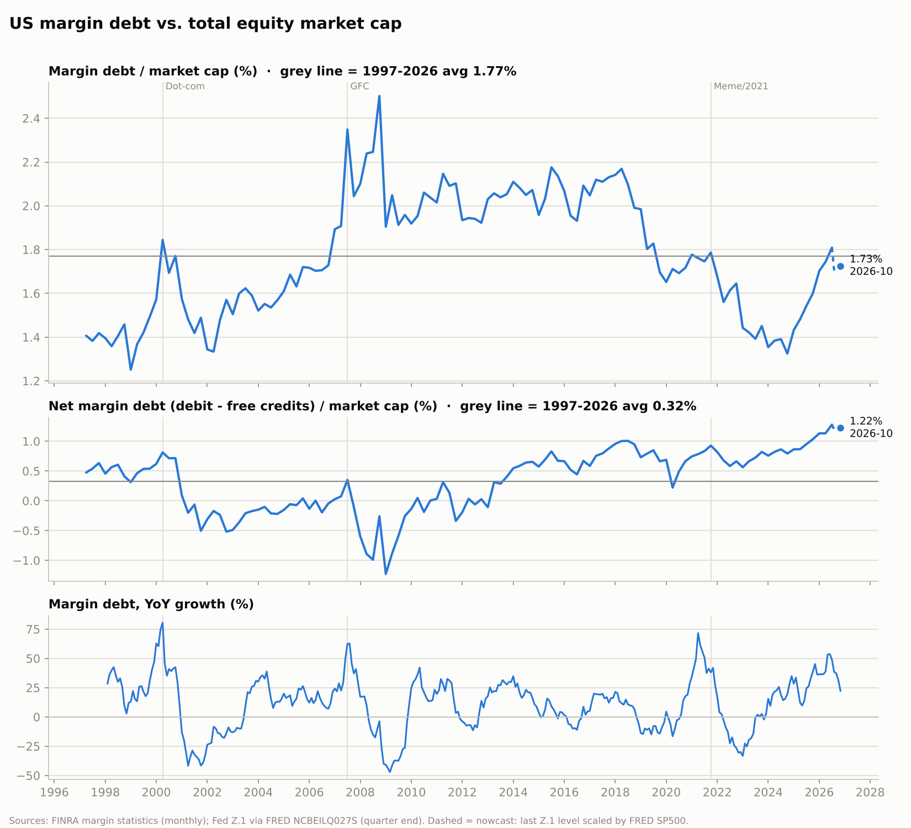

# Margin debt / market cap (EUA)

Indicador de alavancagem do investidor americano: saldo devedor em contas de margem (FINRA) dividido pelo valor de mercado das ações americanas (Fed Z.1, via FRED).



## Como rodar

```bash
pip install pandas requests openpyxl matplotlib
python margin_debt_market_cap.py            # baixa os dados, salva CSV + PNG e imprime o resumo
python margin_debt_market_cap.py --no-plot  # só o CSV
```

Nenhuma chave de API é necessária (usa o endpoint `fredgraph.csv` do FRED e o Excel público da FINRA).

## Fontes

| Série | Fonte | Frequência | Uso |
|---|---|---|---|
| Debit Balances in Customers' Securities Margin Accounts | FINRA Margin Statistics | Mensal (US$ mi) | Numerador (margin debt) |
| Free Credit Balances (cash + margin accounts) | FINRA Margin Statistics | Mensal (US$ mi) | Versão líquida do indicador |
| `NCBEILQ027S`: Nonfinancial Corporate Business; Corporate Equities; Liability | Fed Z.1 via FRED | Trimestral (US$ mi, fim do trimestre) | Denominador (market cap) |
| `SP500` | FRED | Diária | Só para o *nowcast* dos meses após o último Z.1 |

## Metodologia

* **Indicador principal**: `margin_debt / market_cap`, medido no último mês de cada trimestre (a FRED data o nível do Z.1 no 1º dia do trimestre, mas ele se refere ao fim do trimestre).
* **Nowcast**: o Z.1 sai cerca de 10 semanas após o fim do trimestre. Para os meses depois do último Z.1, o market cap é o último nível do Z.1 corrigido pela variação do S&P 500 no fim de cada mês (linha tracejada). Entre 2017 e 2026, a variação trimestral do Z.1 e a do S&P 500 têm correlação de 0,99 e diferença média de -0,1 p.p.
* **Versão líquida**: `(margin debt − free credits) / market cap`. Até jan/2010 (coleta da NYSE) a FINRA publica os free credits em uma coluna só; a partir de fev/2010 (Rule 4521) eles vêm separados. A soma é contínua na quebra.
* **Crescimento anual da margin debt**: variação de 12 meses do saldo devedor.

## Ressalvas

* `NCBEILQ027S` cobre só empresas **não financeiras** e inclui empresas de capital fechado a valor de mercado. É o substituto usual do Wilshire 5000, que saiu do FRED em 2024. Somar o setor financeiro (`BOGZ1LM793164105Q`) contaria duas vezes ETFs e fundos fechados, que o Z.1 classifica como ações emitidas pelo setor financeiro. O formato do indicador praticamente não muda: a correlação entre as duas versões é de 0,99.
* O indicador bruto sobe em crises (2008) por efeito denominador: o market cap cai antes de a margin debt ser desalavancada. Leia junto com o crescimento anual da margin debt.
* Os dados da FINRA começam em 1997.

## Saída

`data/margin_debt_market_cap.csv`: uma linha por mês, com as colunas `margin_debt`, `free_credit_total`, `margin_debt_yoy_pct`, `market_cap`, `mcap_source` (`Z.1` ou `nowcast_sp500`), `margin_debt_to_mcap_pct` e `net_margin_debt_to_mcap_pct`.
